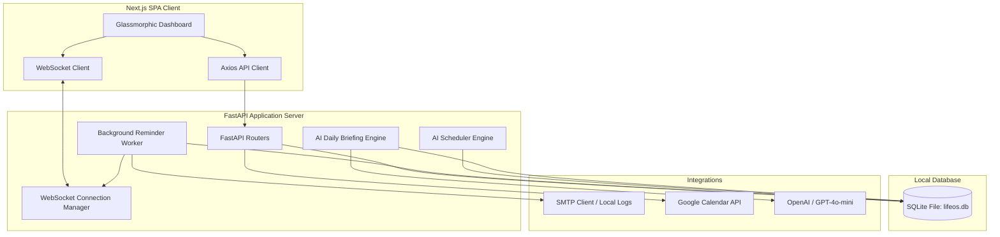

# LifeOS AI - Minimum Viable Product (MVP) Technical Specification & Product Blueprint

## 1. Executive Summary
**LifeOS AI** is an intelligent, offline-first, AI-native Personal Operating System designed to replace scattered productivity apps (Reminders, Calendars, Kanban boards, Notes, and Habit trackers) with a single unified workspace. 

Unlike conventional productivity tools that require manual organization and scheduling, LifeOS AI uses a centralized **AI Chief of Staff** to automatically schedule tasks around calendar events, assess cognitive load, issue real-time adaptive reminders, and summarize unstructured notes.

This document defines the architecture, data schemas, API protocols, and features implemented in the current production-ready MVP.

---

## 2. Core Value Proposition & Problem Statement
Modern professionals face "productivity tool fatigue" by jumping between disconnected applications. 

### The Problems:
1. **Disconnected Context**: Calendars do not know about task priorities; task managers do not know about meeting blocks.
2. **Manual Scheduling Overhead**: Users spend significant time manually time-blocking their weeks.
3. **Static Alerts**: Notifications fire blindly without checking if the task is already done, or if the user is in a state of cognitive overload.
4. **Information Dispersal**: Ideas, notes, and research materials are separate from execution tasks.

### The LifeOS AI Solution:
* **Centralized Database**: All entities (Tasks, Calendar Events, Notes, Projects, Competitions, Habits) share a single SQLite database (`lifeos.db`) for instant local querying.
* **Intelligent Auto-Scheduling**: A heuristic solver reads calendar time blocks and schedules tasks into available free windows based on priority and estimated time.
* **Adaptive Notifications & Smart Snooze**: Reminders are delivered via WebSocket popups and emails in real time, with instant database-backed snoozing.
* **Semantic Summarization**: Notes are analyzed and summarized, feeding into a consolidated daily briefing.

---

## 3. Tech Stack Architecture
The MVP is built with a modern, decoupled architecture designed for local deployment and offline-first usage:



* **Frontend**: Next.js 15, React 19, TypeScript, Tailwind CSS, Lucide Icons, and Framer Motion.
* **Backend**: FastAPI (Python 3.11), Uvicorn, SQLAlchemy ORM.
* **Database**: SQLite (local serverless configuration).
* **Integrations**: Google OAuth & Calendar API, SMTP Email, and OpenAI API (with offline mock fallback capability).

---

## 4. MVP Feature Specifications

### 4.1. Real-Time Dashboard & Productivity Analytics
The central hub aggregates statistics from all subsystems to present a clean overview of the user's productivity state:
* **Completion Rate**: Dynamic calculation of completed vs. total tasks.
* **Focus Time**: Accumulation of estimated minutes for completed tasks.
* **Missed Deadlines**: Counter flag listing active tasks whose due date is in the past.
* **Cognitive Load / Burnout Assessment**: Calculates meeting duration vs. high-priority tasks for the day to return a status of `LOW`, `MEDIUM`, or `HIGH`.
* **Completion Trend Chart**: Displays task completion history over the past 7 days.

### 4.2. AI Task Management with Natural Language Processing (NLP)
* **NLP Parser**: Translates input text (e.g., *"Finish presentation tomorrow at 4pm priority high"*) into structured database fields:
  * Title: `"Finish presentation"`
  * Due Date: Tomorrow at `16:00`
  * Priority: `HIGH`
* **Status States**: Tasks transition between `TODO` ➔ `IN_PROGRESS` ➔ `DONE` via simple board controls.

### 4.3. Heuristic AI Scheduler
Calculates the optimal week plan by parsing free calendar blocks:
1. Scans calendar events for the next 7 days.
2. Identifies "awake" free time windows (defaulting between `08:00` and `22:00`).
3. Allocates task time blocks (using `estimatedMinutes` or defaulting to 45 mins) in priority order (`URGENT` ➔ `HIGH` ➔ `MEDIUM` ➔ `LOW`).
4. Updates `scheduledStart` and `scheduledEnd` in the task row, instantly reflecting on the user's dashboard.

### 4.4. Adaptive Reminders & Smart Snooze
* **Background Worker**: Polls the database every 5 seconds for pending alerts.
* **CORS-Bypassed WebSockets**: Pushes alerts instantly to the active browser tab.
* **SMTP Dispatcher**: Sends notifications to `anandhappriya@gmail.com`. Logs to `email_delivery_log.txt` if credentials are not configured.
* **Smart Snooze API**: POST `/reminders/{id}/snooze` sets a new `scheduledTime` (e.g., +5 minutes), resets status to `PENDING`, and increments `snoozeCount`.
* **Automatic Escalation**: For tasks with priority `URGENT` or status `ESCALATING` that remain incomplete, the worker raises warning levels and sends louder warnings.

### 4.5. Second Brain Notes & AI Summarization
* **Markdown Support**: Allows capture of unstructured logs, ideas, and documentation.
* **AI Summarization**: Extracts key actionable items into a concise summary block to reduce reading time.

### 4.6. Habit & Goal Tracker
* **Habits**: Tracks frequencies (DAILY/WEEKLY) and increments streaks dynamically.
* **Goals**: Maps percentage progress values toward deadline-driven milestones.

### 4.7. Competitions & Projects Hub
* **Competitions**: Checklist tracking (PPT, Report, Code Submission, Demo Link) that updates completion progress automatically.
* **Projects**: Group tasks and milestone dependencies to track high-level development.

---

## 5. Database Schema (SQLite / SQLAlchemy)

The database schema is defined in `backend/app/models/models.py`. The relationships are mapped as follows:

### 5.1. `User` Table
Stores basic profile information.
* `id` (String, PK)
* `email` (String, Unique)
* `name` (String)
* `createdAt` / `updatedAt` (DateTime)

### 5.2. `Settings` Table
Stores sync profiles and credentials.
* `id` (String, PK)
* `userId` (String, FK -> User)
* `theme` (String)
* `googleSyncEnabled` (Boolean)
* `googleAccessToken` / `googleRefreshToken` (String)
* `googleTokenExpiry` (DateTime)
* `syncEmail` (String)
* `notificationTypes` (JSON)

### 5.3. `Task` Table
Stores schedule elements.
* `id` (String, PK)
* `userId` (String, FK -> User)
* `title` (String)
* `description` (String)
* `status` (String: TODO, IN_PROGRESS, DONE)
* `priority` (String: LOW, MEDIUM, HIGH, URGENT)
* `dueDate` / `scheduledStart` / `scheduledEnd` (DateTime)
* `estimatedMinutes` (Integer)
* `projectId` (String, FK -> Project)
* `competitionId` (String, FK -> Competition)

### 5.4. `CalendarEvent` Table
Stores sync outcomes.
* `id` (String, PK)
* `userId` (String, FK -> User)
* `googleEventId` (String)
* `title` (String)
* `description` (String)
* `startTime` / `endTime` (DateTime)
* `calendarEmail` (String)

### 5.5. `Reminder` Table
Stores real-time alerts.
* `id` (String, PK)
* `userId` (String, FK -> User)
* `taskId` (String, FK -> Task)
* `scheduledTime` (DateTime)
* `status` (String: PENDING, SENT, SNOOZED, CANCELLED)
* `recurrence` (String: NONE, DAILY, WEEKLY)
* `snoozeCount` / `escalationCount` (Integer)
* `contextData` (JSON)

---

## 6. Key API Enpoints & WebSockets

### Authentication
* `GET /api/v1/auth/me` - Resolves the current session user.

### Tasks
* `GET /api/v1/tasks/` - Fetches all tasks.
* `POST /api/v1/tasks/` - Creates a new task.
* `POST /api/v1/tasks/quick-parse` - Takes a text string and uses NLP to parse and insert the task.
* `PUT /api/v1/tasks/{id}` - Updates status or scheduled start time.

### AI Scheduler & Assistant
* `POST /api/v1/scheduler/auto-schedule` - Runs the free block time allocation algorithm.
* `GET /api/v1/ai/daily-briefing` - Generates today's schedule briefing and burnout load.
* `POST /api/v1/ai/chat` - Chats with the AI Chief of Staff (supports commands like *auto-schedule* or *next action*).

### Reminders & Analytics
* `POST /api/v1/reminders/{id}/snooze` - Snoozes an active reminder.
* `GET /api/v1/analytics/` - Fetches dynamic dashboard completion metrics.

### Google Calendar OAuth
* `GET /api/v1/calendar/auth-url` - Returns Google consent URL (or simulated loop url).
* `GET /api/v1/calendar/oauth2callback` - Receives code, exchanges for tokens, saves, and redirects.
* `POST /api/v1/calendar/sync` - Synchronizes calendar events.

---

## 7. Setup & Run Instructions

### Prerequisites:
* Python 3.11+
* Node.js 18+

### Running the Backend:
1. Navigate to the backend folder:
   ```bash
   cd C:\Users\hp\lifeos-ai\backend
   ```
2. Activate virtual environment:
   ```powershell
   venv\Scripts\activate
   ```
3. Start the server:
   ```bash
   uvicorn app.main:app --host 127.0.0.1 --port 8000
   ```

### Running the Frontend:
1. Navigate to the frontend folder:
   ```bash
   cd C:\Users\hp\lifeos-ai\frontend
   ```
2. Start development mode:
   ```bash
   npm run dev
   ```
3. Open `http://localhost:3000` in your web browser.
